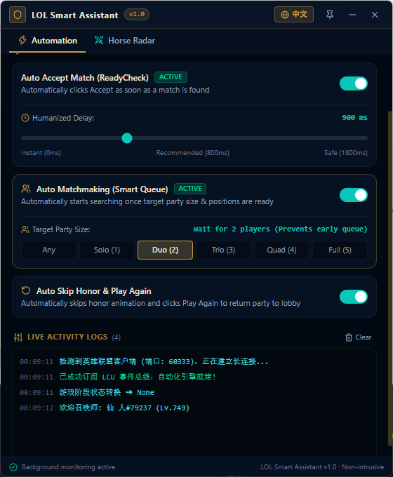
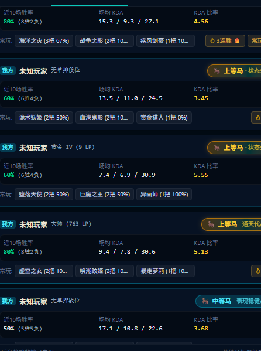

# LOL-tool (LOL Smart Assistant v1.0.2)

<p align="center">
  
  
  
  
  
  
</p>

<p align="center">
  <b>Clean · Smooth · Safe · Tailored for Hextech ARAM & Ranked Matchmaking</b>
</p>

<p align="center">
  <b>🌐 Language Switcher:</b> <a href="README_EN.md"><b>English Documentation</b></a> | <a href="README.md"><b>中文说明文档</b></a>
</p>

---

## 📖 Introduction

**LOL-tool** is a high-performance, lightweight, and modern desktop companion designed for League of Legends, built with **Wails v2 (Go 1.25) + React 19 + TypeScript + Tailwind CSS**.

### Core Philosophy
1. **100% Zero-Memory-Injection (Anti-Ban & Vanguard Safe)**: Interacts solely through Riot's official LCU (League Client Update) REST API and WebSocket full-duplex event bus. It never injects code into or alters the memory of the game executable (`League of Legends.exe`), making it completely compliant with Riot Developer Policies and Vanguard safe.
2. **Tiny Footprint & Ultra Performance**: Compressed using UPX down to just **~4.01 MB**. Operates as a single portable binary with zero external dependencies. Consumes merely **~30 MB RAM** and under 0.2% CPU in the background.
3. **Quiet & Non-Intrusive**: Runs silently in the background. It **never automatically spams in-game chat**; all match tactical reports are sent strictly under your explicit manual control.
4. **Instant Bilingual Support**: Features a built-in one-click English/Chinese toggle button in the top header, with persistent memory of your language preference.

---

## 📸 Application Screenshots

<div align="center">
  <table border="0">
    <tr>
      <td align="center" width="50%">
        <b>⚡ Automation & Live Bilingual Activity Logs</b><br/><br/>
        
      </td>
      <td align="center" width="50%">
        <b>🐎 Match Horse Radar & Stat Penetration</b><br/><br/>
        
      </td>
    </tr>
  </table>
</div>

---

## ✨ Features

### 1. ⚡ Core Automation
- **Auto Accept Ready Check**:
  - Millisecond-level WebSocket event detection triggers match acceptance the instant a match is found.
  - **Humanized Anti-Ban Delay Slider**: Configurable from 0ms (Instant lock), 800ms (Recommended human reflex), to 1800ms (Safe casual delay).
- **Smart Lobby Matchmaking (Smart Queue)**:
  - Intelligently senses party size and member readiness.
  - **Custom Target Party Size Filter**: Choose between `Any / Solo (1) / Duo (2) / Trio (3) / Quad (4) / Full Team (5)`.
  - Automatically starts matchmaking *only* when the target headcount is met and all players are ready, eliminating accidental early queues while friends are AFK or choosing lanes!
- **Auto Skip Honor & Play Again**:
  - Automatically skips lengthy post-game honor ceremonies and progression celebration animations.
  - Calls `/lol-lobby/v2/play-again` to return the entire party back into the lobby together without requiring the host to recreate the room or re-invite friends.

---

### 2. 🐎 6-Tier Full-Spectrum Battle Power Radar (Hextech ARAM Multi-Pillar Engine)

Upon entering **Champ Select** or an **Active Match (InProgress)**, the tool analyzes recent match records of all 10 players concurrently via high-speed Go routines, presenting an intuitive **6-tier pyramid rating system** alongside in-depth tactical badges.

#### 🏆 6-Tier Hierarchy Overview

| Tier | Score Range | Unified Card Badge | In-Game Performance & Archetype |
| :---: | :---: | :--- | :--- |
| **S+** | $\ge 140$ pts | **👑 S+ Grand · Transcendent Carry** | **Raid Boss**: Damage share >30%, multi-penta/quadra kills, 65%+ win rate & hot streak. Protect him to win! |
| **S** | $120 \sim 139$ | **⚔️ S Core · Team Helmsman** | **Major Pillar**: Damage share 26%+, or 35%+ tanking share frontline with Horn. Highly dependable. |
| **A** | $100 \sim 119$ | **🛡️ A Solid · Team Anchor** | **Solid Performer**: Stats hover near 20% team baseline, solid team player who listens and doesn't feed. |
| **B** | $85 \sim 99$ | **⚠️ B Wavering · Rollercoaster** | **Slight Drag**: Sub-par damage share (13%~16%), requires allies to pick up the slack. |
| **C** | $70 \sim 84$ | **🚨 C Vulnerable · Tilt Point** | **Liability**: High deaths, low damage contribution, primary target for enemies and focus for ally caution. |
| **D** | $< 70$ pts | **🐮 D Disaster · Bottom Feeder** | **Walking Disaster**: On a 4+ loss tilt streak today, 10+ deaths per game, extreme tilt. Explicit warning! |

#### 🧠 5-Pillar Comprehensive Decision Engine

1. **Role Tactical Share (40%) —— Rebuffing Damage Inflation**:
   - Rejects raw damage values that are inflated by Hextech augments;
   - Calculates **Damage Share %**, **Damage Taken Share %**, and **Heal Share %** relative to the 20% team baseline.
2. **Itemization & Duration Awareness (15%) —— Dynamic Guardian Items**:
   - Tracks Guardian items (Horn 2051, Blade 3177, Hammer 3184, Orb 3112);
   - Duration-aware: Evaluates Horn in <16min games; selling Guardian items at 20+ min full build is acknowledged as high-tier play without penalty!
3. **Mental State & Tilt Index (20%) —— Tilt Override Power**:
   - Players on a 4+ losing streak today with inflated deaths are marked as `⚠️ Tilt Warning` and **stripped of S/A tier eligibility**;
   - 3+ game win streaks trigger the `🔥 Hot Streak` aura.
4. **Highlights & Objectives (15%) —— Multi-Kills & Turret Damage**:
   - Accounts for Penta, Quadra, and Triple kills;
   - Factors in **Damage Dealt to Turrets** to reward players focused on destroying the nexus.
5. **Extreme Win Rate Activation (10%) —— Big Sample Anti-RNG**:
   - Neutral weight between 45%~60%;
   - High weights only activate in extreme territory ($\ge 70\%$ or $\le 35\%$).

---

### 3. 💬 Assembled Horse Report Console (Manual Control)

**We strictly oppose uninvited automatic chat flooding.**

The helper assembles a clean, concise single-line briefing summarizing key intelligence:
- ⚠️ **Ally Liability Warning**: Informs the team of struggling allies to play more defensively around them.
- 🚨 **Enemy Smurf Alert**: Highlights enemy high-winrate or high-rank threats to prioritize in fights.
- 🎯 **Enemy Weak Link**: Identifies low-participation, tilting opponents as prime targets to initiate upon.
- 💪 **Ally Core Carry**: Highlights dependable teammates to play around.

#### Two Convenient Sharing Modes:
1. **Champ Select Team Chat**: Click `Send to Champ Select Chat` to immediately output the tactical summary into the lobby chat via official client endpoints.
2. **In-Game 1-Click Copy**: In loading or in-game, click `In-Game Chat (Copy & Paste)` to copy to clipboard; in-game, simply press `Enter` ➔ `Ctrl+V` ➔ `Enter` (0.5 seconds).

---

### 4. 🌐 Real-Time Bilingual Toggle
- Features a top-right header button (`🌐 EN` / `🌐 中文`).
- Instantly translates the entire interface with zero lag or screen flicker.
- Remembers your selection automatically using local browser storage.

---

### 5. 🛡️ Process-Level Zero-Crash Architecture
- **Win32 Memory Bounds Safety**: Guards against PEB buffer overflows and indexing exceptions during client startup/shutdown.
- **Sub-Goroutine Panic Isolation**: All Go service routines and event handlers are enclosed in `defer recover()` boundaries. Even if the League client abruptly closes or sends malformed payloads, the helper handles it gracefully without closing.
- **Defensive React Rendering**: All statistical calculations feature nullish coalescing to prevent UI white-screen crashes.

---

### 6. 🚀 Smart & Non-Forced GitHub Release Updates
- **Authoritative GitHub Releases Baseline**: Queries GitHub Releases API on startup or manual click, comparing SemVer tags accurately.
- **100% Non-Intrusive**: Never forces or locks the UI. Users can dismiss with a single click or continue using the app completely undisturbed.
- **One-Click In-App Update**: Downloads the latest release with live progress tracking, safely hot-replaces the executable, and restarts smoothly.
- **Dual Fallback to Browser**: Supports direct redirection to GitHub Releases page if network conditions restrict in-app downloads.


---

## 🚀 Getting Started

### Option 1: Run the Precompiled Binary (Recommended)
1. Download the latest single executable directly from GitHub Releases: [**lol-helper-v1.0.exe**](https://github.com/mengjio007/LOL-tool/releases/latest/download/lol-helper-v1.0.exe) (~3.85 MB, direct download).
2. Launch the League of Legends client (any order works; the assistant automatically detects and hooks the LCU event bus).
3. Double-click `lol-helper-v1.0.exe` to run.

---

### Option 2: Build from Source

#### Prerequisites:
- [Go](https://go.dev/) 1.22+ or 1.25+
- [Node.js](https://nodejs.org/) 18+ (with npm)
- [Wails CLI v2](https://wails.io/): `go install github.com/wailsapp/wails/v2/cmd/wails@latest`
- [UPX](https://upx.github.io/) (optional, for PE binary compression)

#### Build Instructions:
```powershell
# 1. Clone this repository
git clone git@github.com:mengjio007/LOL-tool.git
cd LOL-tool

# 2. Install frontend dependencies
cd frontend
npm install
cd ..

# 3. Execute automated build & compression script
powershell -ExecutionPolicy Bypass -File .\build.ps1
```
The compressed single binary `lol-helper-v1.0.exe` (~4.0 MB) will be generated in the root directory.

---

## 🛠️ Architecture & Tech Stack

| Layer | Technology | Role |
| :--- | :--- | :--- |
| **Desktop Framework** | [Wails v2](https://wails.io/) | High-performance Go + native WebView2 bridge (No bulky Electron runtime) |
| **Backend Core** | [Go 1.25](https://go.dev/) | Ultra-fast concurrency, Win32 PEB process discovery, LCU REST & WebSocket |
| **Frontend UI** | [React 19](https://react.dev/) + [TypeScript](https://www.typescriptlang.org/) | Modern component architecture, type-safe state management |
| **Bundler** | [Vite 8](https://vitejs.dev/) | Sub-second HMR and optimized production bundling |
| **Styling** | [Tailwind CSS v4](https://tailwindcss.com/) | Hextech dark fantasy UI theme |
| **Iconography** | [Lucide React](https://lucide.dev/) | Crisp modern vector icons |
| **Compressor** | [UPX 5.2.1](https://upx.github.io/) | Lossless executable packaging (11.5MB -> 4.0MB) |

---

## ⚖️ Disclaimer

1. This project is an open-source educational utility intended to assist League of Legends players with team formation and pick decisions.
2. It interacts exclusively with public Riot Games LCU client APIs. **It does not contain any memory injection, disassembly tampering, bot scripts, or unfair competitive advantages.**
3. Please use this tool responsibly and respectfully.
4. League of Legends is a registered trademark of Riot Games, Inc. This project is not affiliated with or endorsed by Riot Games.

---

## 📄 License

This project is licensed under the [MIT License](LICENSE).
